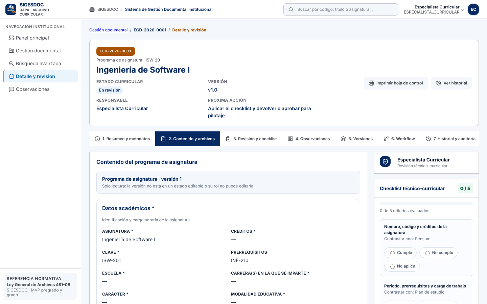
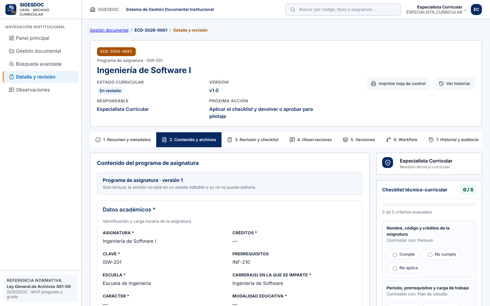
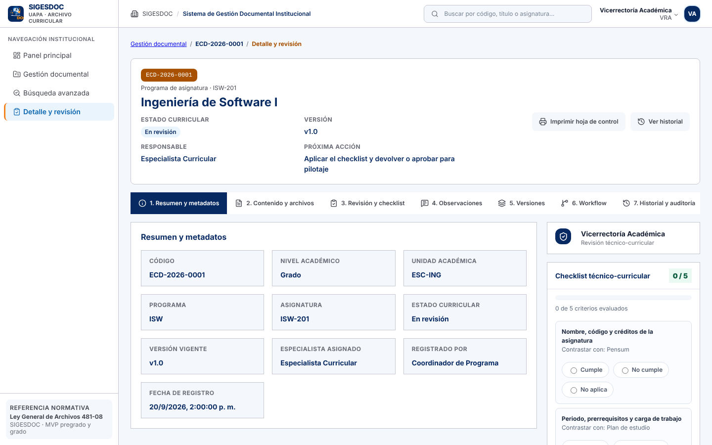
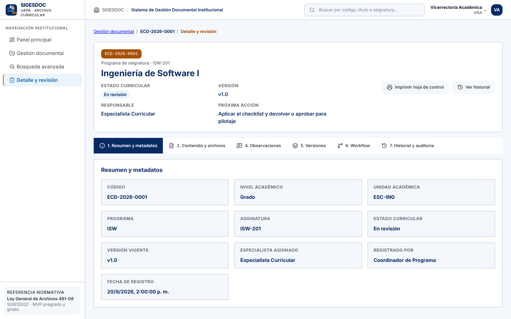
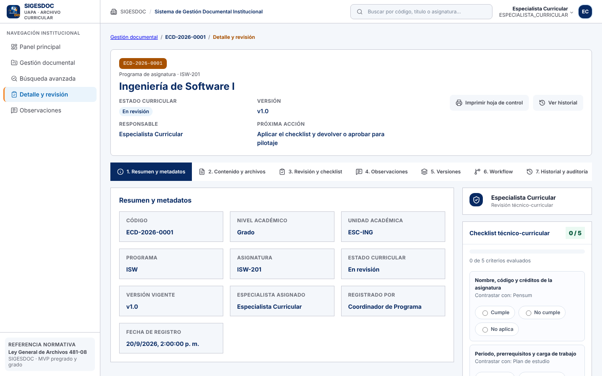

# Informe de diagnóstico de SIGESDOC Frontend

Fecha: 7 de noviembre de 2026. Versión analizada: v0.3.0, rama `claude/blissful-hamilton-xcsnao`.

## 1. Recuperación, entorno y ejecución

| Paso                  | Resultado                                                                                                          |
| --------------------- | ------------------------------------------------------------------------------------------------------------------ |
| Repositorio           | `alejandroalbaine/Sigedocs`, clonado y en la rama de trabajo                                                       |
| Dependencias          | `npm ci` sin errores (Node 22 según `.nvmrc`)                                                                      |
| `npm run check`       | Formato, tipos, 272 pruebas, lint, stylelint y build: todo en verde antes de tocar                                 |
| Ejecución             | `vite` arranca en 166 ms; la interfaz responde en el navegador                                                     |
| Backend real          | No disponible en el entorno de revisión (sin API ni PostgreSQL). Sí corre en la máquina del equipo (Figuras 1 a 4) |
| Cómo se ejecutó la UI | Con un backend simulado (rutas interceptadas con Playwright) y datos de prueba                                     |

Consecuencia: las pruebas y las capturas de antes y después de la sección 5 se obtuvieron con el
backend simulado. No se repitió la integración contra el servidor real (`SIGESDOC_BACKEND`).

### Evidencia del entorno del equipo

Las cuatro capturas siguientes las aportó el equipo desde su máquina de trabajo.

Lo que estas capturas muestran, y lo que no:

- La interfaz arranca y muestra al usuario y su rol con datos del servidor (Figura 3).
- El aviso de permiso de la Figura 3 es un hallazgo nuevo (D-07).
- El backend declara la versión 1.0.0, mientras que la documentación del frontend habla de la
  v0.3.0. Conviene aclarar cómo se numeran las versiones de cada repositorio.
- No se repitieron en ese entorno las pruebas del informe.

## 2. Tecnologías, componentes y estructura

- React 19, TypeScript estricto y Vite 8; React Router 7 en modo librería.
- CSS Modules con un único sistema de tokens; Vitest 5, Testing Library, ESLint, Stylelint y Prettier.
- Docker + Nginx para producción; GitHub Actions publica la imagen (`amd64` y `arm64`).
- Unas 12 500 líneas en `src`, 38 archivos de prueba.

| Carpeta               | Contenido                                                                           |
| --------------------- | ----------------------------------------------------------------------------------- |
| `src/common/api`      | Cliente HTTP, validadores del contrato (`dossierContract`, `templateContract`)      |
| `src/common/auth`     | Sesión, permisos (`permissions.ts`) y rutas protegidas                              |
| `src/pages`           | Una carpeta por pantalla: Dashboard, Gestión, Búsqueda, Registro, Revisión, etc.    |
| `src/features`        | Lógica por dominio: programa (formulario), revisión, versiones, usuarios, auditoría |
| `src/test`            | Backend simulado, fixtures y utilidades de prueba                                   |
| `contratos/`, `docs/` | Contrato de endpoints, de plantillas y guías del equipo                             |

Archivos más grandes: `RegistroPage.tsx` (779 líneas), `RevisionPage.tsx` (593),
`FormularioPrograma.tsx` (517), `templateContract.ts` (481).

## 3. Documentado frente a lo que funciona

| Afirmación documentada                                        | Comprobación                                                                                                   | Resultado        |
| ------------------------------------------------------------- | -------------------------------------------------------------------------------------------------------------- | ---------------- |
| 272 pruebas, todas en verde (`CHANGELOG`)                     | `vitest run`: 272 de 272                                                                                       | Coincide         |
| Build de producción y lint limpios                            | `npm run check`                                                                                                | Coincide         |
| Siete pestañas del expediente (Informe T1)                    | Se ven las siete con rol revisor                                                                               | Coincide         |
| Checklist y dictamen son de la revisión técnica               | Se mostraban a un rol de solo consulta                                                                         | **No coincidía** |
| README: «catálogos pendientes» en el backend                  | El código y el `CHANGELOG` v0.3.0 ya los consumen                                                              | **Desfasado**    |
| README: «Verificado contra el backend v0.2.0»                 | `CHANGELOG` indica verificación con v0.3.0 (33 casos)                                                          | **Desfasado**    |
| El formulario del programa parte de lo elegido en el registro | Escuela y carrera salían vacías                                                                                | **No coincidía** |
| Integración con el backend real                               | La interfaz inicia sesión contra el backend local (Figura 3), pero el panel muestra un aviso de permiso (D-07) | Parcial          |

## 4. Hallazgos

### Defectos

| ID   | Severidad | Hallazgo                                                                                                                                                                                                                        | Estado                                                         |
| ---- | --------- | ------------------------------------------------------------------------------------------------------------------------------------------------------------------------------------------------------------------------------- | -------------------------------------------------------------- |
| D-01 | Media     | El formulario del programa no heredaba la escuela y la carrera del registro                                                                                                                                                     | **Corregido**                                                  |
| D-02 | Media     | El checklist técnico y el dictamen se mostraban a quien no revisa                                                                                                                                                               | **Corregido**                                                  |
| D-03 | Baja      | README desfasado respecto a catálogos y versión del backend                                                                                                                                                                     | **Corregido**                                                  |
| D-06 | Media     | El formulario del programa ofrecía las carreras de todas las escuelas, sin filtrar por la escuela del registro                                                                                                                  | **Corregido**                                                  |
| D-07 | Media     | Con el backend local, el panel del Especialista Curricular muestra «No tiene permiso para realizar esta acción» y los contadores en cero (Figura 3). Probable `403` de `GET /dossiers`; falta confirmar la causa con el backend | **Abierto**                                                    |
| D-04 | —         | Descartado: la cabecera muestra el código del rol solo si `GET /roles` falla (como en la simulación). Es el comportamiento previsto                                                                                             | Descartado                                                     |
| D-05 | —         | Siete defectos del Módulo V citados en el `CHANGELOG` sin lista en el repositorio                                                                                                                                               | Sin lista: se buscó en issues de GitHub, Trello y Drive (7/11) |

### Deuda técnica

| ID    | Hallazgo                                                                                                     |
| ----- | ------------------------------------------------------------------------------------------------------------ |
| TD-01 | Permisos duplicados en español e inglés (`permissions.ts`) a la espera de REF-02 del backend                 |
| TD-02 | El build genera un único bloque de 508 kB; solo el comparador de versiones está dividido                     |
| TD-03 | Componentes de página muy grandes (`RegistroPage`, `RevisionPage`) con lógica y presentación mezcladas       |
| TD-04 | Dos `eslint-disable react-hooks/exhaustive-deps` (`useRecurso`, y el nuevo de `FormularioPrograma`)          |
| TD-05 | Sin métrica de cobertura de pruebas; la integración con el backend real (`vite.b3.config.ts`) no corre en CI |
| TD-06 | `docs/pendientes-backend.md` y `cumplimiento-contratos.md` llevan fecha del 27/09 y no reflejan la v0.3.0    |

### Requisitos pendientes

- Pantalla para dar de alta asignaturas.
- Envío real de correos (a la espera de que TI verifique el dominio).
- Diferidos por el Informe del Módulo II §5.1: carga persistente de archivos, OCR, firma o sellado
  digital, rama de posgrado y gestión archivística avanzada.

### Oportunidades de mejora

- Dividir por ruta (`React.lazy`) para bajar el bloque inicial.
- Ejecutar las pruebas de integración contra un backend real en CI.
- Medir cobertura y fijar un mínimo.
- Mostrar un mensaje claro («Aún no tiene expedientes asignados») en lugar de un error de permiso cuando el especialista no tenga expedientes (D-07).
- Alinear el número de versión del frontend (0.3.0) y del backend (1.0.0) o documentar su relación.

## 5. Correcciones realizadas

### D-01 · Escuela y carrera heredadas del registro

`heredarDelRegistro` (`src/features/programa/contenido.ts`) rellena `escuela` y `carreras` con el
código del registro, solo si el campo está vacío y el catálogo contiene ese código. Un valor ya
guardado en la versión nunca se sobrescribe.

| Antes                                                 | Después                                                   |
| ----------------------------------------------------- | --------------------------------------------------------- |
|  |  |

### D-02 · Checklist solo para quien revisa

`RevisionPage.tsx` muestra la pestaña «Revisión y checklist», el panel lateral y el dictamen solo
si el usuario puede devolver o aprobar. La numeración de las pestañas se conserva (1 a 7).

| Antes (rol de solo consulta)                        | Después (rol de solo consulta)                          |
| --------------------------------------------------- | ------------------------------------------------------- |
|  |  |

Con rol revisor no cambia nada: 

### D-03 · README

Se corrigió la tabla de módulos y el párrafo sobre catálogos.

### D-06 · Carreras filtradas por escuela

El formulario pide `GET /institutional-catalogs/degree_programs?schoolCode=…` con la escuela guardada
en la versión o, si no hay, la del registro. Al elegir otra escuela se vuelven a pedir las carreras y
se vacían las ya marcadas, que dejan de ser válidas.

## 6. Pruebas

| Comprobación                              | Antes | Después                   |
| ----------------------------------------- | ----- | ------------------------- |
| Pruebas                                   | 272   | **275** (todas aprobadas) |
| `tsc`, ESLint, Stylelint, Prettier, build | OK    | OK                        |

Pruebas nuevas o modificadas:

- `FormularioPrograma.test.tsx`: hereda escuela y carrera; no sobrescribe una escuela ya guardada; filtra las carreras por escuela y las vuelve a pedir al cambiarla.
- `RevisionPage.test.tsx`: el rol de solo consulta no ve checklist, panel ni la pestaña 3 (sustituye
  a la prueba anterior, que daba por buena la visibilidad del mensaje de rol sin decisiones).

Las capturas se generaron con `vite` y un backend simulado; no provienen de un servidor real.
